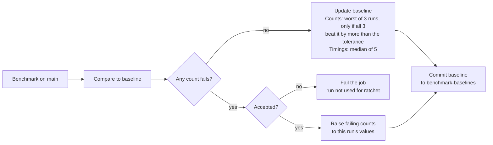

# Automatic Benchmark Baselines

Design doc, Oct 30, 2026

Status: in progress in [#1107](https://github.com/ikostan/SkyLockAssault/issues/1107).
[#1109](https://github.com/ikostan/SkyLockAssault/issues/1109) added the ratchet,
the rolling medians and the accept rule to `compare.py`.
[#1111](https://github.com/ikostan/SkyLockAssault/issues/1111) turns them on in CI.

Source: the design doc in
[[EPIC] Automatic CI benchmark baselines #1107](https://github.com/ikostan/SkyLockAssault/issues/1107).
How the benchmark itself runs is in
[Performance_Benchmark_Guide.md](Performance_Benchmark_Guide.md).

## Problem

The CI benchmark baselines (`test/benchmark/baseline_ci.json`,
`baseline_web_ci.json`) are committed files that only change by hand, so
improvements are never locked in. They still come from the PR
[#1094](https://github.com/ikostan/SkyLockAssault/pull/1094) merge run
(`ee128f9`).

The first `main` run after PR
[#1098](https://github.com/ikostan/SkyLockAssault/pull/1098) shows why that
matters: settings saves dropped from 61 to 0 on desktop and from 60 to 0 on
web, and CI marked both green, but the baseline still says 61. With a count
tolerance of 2, a change that brought the per-tick save back would show 61
against 61 and pass. Goal: baselines that maintain themselves, with no manual
file edits.

## Counts: a ratchet that only moves down

After each `main` run, each count baseline becomes the worst value of the last
3 passing `main` runs, but only when all 3 beat the current baseline by more
than that metric's tolerance. Counts are the gate: settings saves, objects,
nodes, resources, orphans and reload growth. On web, objects and nodes only
warn and follow the timing rule instead (see below).

A run here means one `main` pipeline run. Each one is already the median of 3
benchmark iterations (`runs: 3`), so 3 runs cover 9 iterations. Only passing
runs are recorded: a run that fails on a count is skipped, so it neither
counts toward the 3 nor resets them.

- **A real improvement locks in by itself.** It beats the baseline by more
  than its tolerance in 3 passing runs, so the baseline drops to it. With
  [#616](https://github.com/ikostan/SkyLockAssault/issues/616), saves would
  lock at 0 after three passing `main` runs.
- **Noise cannot tighten the gate.** The tolerances already reflect measured
  noise, so a gain inside them never moves a baseline. Without that margin, 3
  slightly low runs would nudge float averages down for good. Desktop reload
  growth spans 2 to 12 on runners against a tolerance of 10, so a few low runs
  would soon fail normal ones.
- **A slow creep cannot loosen it.** The baseline never goes up on its own, so
  small regressions that each fit inside the tolerance cannot add up.

The ratchet does not change the tolerances. It decides where the baseline sits.
The tolerance decides how much worse a run may be before the job fails. It
also decides how much better 3 runs must be before the baseline moves.

## Timings: a rolling reference that only warns

The reference for each timing metric is the median of the last 5 passing
`main` runs, recomputed on every run. That covers frame p95, dropped frames,
process and physics worst frame per second, and memory growth.

It also covers web objects and nodes. Their averages follow runner speed:
nodes\_avg was 459 on a fast runner and 516 to 519 on slower ones, with no
code change. So on web they warn like timings and are not ratcheted. A ratchet
would lock in a fast-runner dip, and the next normal run would fail. Desktop
keeps them on the count gate.

- It adapts by itself when the runner image, Godot or Chromium changes, within
  about 3 runs.
- It still flags a sudden jump against recent history.
- Timings stay warnings only, as today: shared runners are too noisy to fail a
  job on them.

A rolling reference does not catch slow creep, and it absorbs a real jump
after about 3 runs. The warning shows on a run or two, then goes quiet, so
silence is not proof of no regression.

Desktop runs Godot `--headless`, which renders nothing. Rendering cost shows
only in the web job's software-rendered timings. On desktop, the 3D
SubViewport player in Milestone 28 will show only as more nodes and
resources.

## When a count is meant to get worse

A `benchmark-accept` label on the PR raises the failing count baselines to
that merge run's values. New gameplay will legitimately add objects and nodes,
and that needs an explicit signal rather than a file edit.

- **With the label:** after merge, only the counts that failed are raised to
  that run's values, and the PR number is recorded. Every other count stays on
  the ratchet, so one run never tightens the gate.
- **Without the label:** a worse count fails the `baselines` job, and that run
  is not used for the ratchet. The benchmark jobs only report and stay green.

**Numbers before merge.** Pull requests that touch game code also run the
benchmark, gated by the existing `dorny/paths-filter` step. They compare
against the branch baseline, only report and write nothing. So the label is
set from the PR's numbers, not guessed.

The label must be on the PR before it merges. The push to `main` carries no
PR, so the job looks it up with
`gh api repos/{repo}/commits/$GITHUB_SHA/pulls`, which needs
`pull-requests: read`. A direct push has no PR and counts as unlabeled.
`benchmark_baselines.yml` is called from `lint_test_deploy.yml` with
`workflow_call`, like `benchmark.yml`, so `$GITHUB_SHA` is the merge commit
the benchmark measured. The manual run uses the selected run's head SHA
instead.

**Forgot the label?** Run `benchmark_baselines.yml` by hand
(`workflow_dispatch`) with the failed run's ID and `accept: true`. It reuses
that run's results and raises the failing counts the same way. Without it,
every later `main` run fails: the baseline stays put and failing runs are not
recorded.

**Which runs it accepts.** Before it changes anything, the manual run checks
that the run ID points at a trusted `main` benchmark run, and stops with the
reason in the job summary if any check fails:

- The run comes from this repository's main CI/CD pipeline, matched by its
  workflow file path rather than its display name.
- It was triggered by a `push` to `main` in this repository, not by a pull
  request, a fork or another branch.
- It has finished, its `desktop` and `web` benchmark jobs passed, and its
  `benchmark-results` and `benchmark-web-results` artifacts both exist and have
  not expired. Those jobs only report, so one that failed did not measure.
- The `commit` in each artifact's baseline file equals the run's head SHA.

Missing, mismatched or untrusted results raise nothing. The approval stays
explicit: only someone with write access can start `workflow_dispatch`, and
the run does nothing without `accept: true`.

The label, or the manual accept run, is the only human action in the whole
scheme, and it is a decision, not maintenance.

<!-- markdownlint-disable MD013 -->

<!-- markdownlint-enable MD013 -->

Every `main` run ends with a baseline commit unless a count fails without an
accept, by label or manual run; then the job fails and the baseline stays
put.

## Where the baseline lives

The baselines move to an orphan branch, `benchmark-baselines`, that a single
workflow job updates. It holds `desktop.json` and `web.json`: the current
count baseline plus the last 5 passing runs the two rules need.

- `main` stays protected, and no bot pull requests are needed.
- One `baselines` job runs after `desktop` and `web`. It lives in its own
  workflow, `benchmark_baselines.yml`, and runs on `main` only. It downloads
  both results artifacts, applies the gate and the rules, and pushes once.
  Keeping it separate keeps write access out of the PR pipeline, whose token
  is read-only. One push also avoids a race between the two parallel
  benchmark jobs, which now only measure and report.
- Only that job gets `contents: write`, `pull-requests: read` and
  `actions: read`. The manual run needs `actions: read` to check the selected
  run and download its artifacts. The jobs that run pip, Playwright and Godot
  keep `contents: read` and `persist-credentials: false`.
- Every update is a commit naming the run ID and SHA, so `git log` on that
  branch shows when and why each baseline moved.
- A concurrency group on the `baselines` job, with
  `cancel-in-progress: false` and `queue: max`, stops two `main` runs from
  overwriting each other. Without the queue, a newer pending run replaces an
  older pending one, and that run drops out of the gate and the history. The
  queue holds up to 100 runs, far more than merges to `main` produce.

<!-- markdownlint-disable MD013 -->
| Option                    | Why not                                                 |
|---------------------------|---------------------------------------------------------|
| Actions cache             | Evicted after 7 days without use                        |
| Workflow artifacts        | Expire, and cannot be read back reliably by a later run |
| Committed files on `main` | Today's manual process; `main` is protected             |
<!-- markdownlint-enable MD013 -->

### Seed

[#1110](https://github.com/ikostan/SkyLockAssault/issues/1110) created the
branch by hand at `c7b14a5`. Nothing reads it until
[#1111](https://github.com/ikostan/SkyLockAssault/issues/1111).

- **Source:** the values were measured on GitHub's runners in
  [run 41155653694](https://github.com/ikostan/SkyLockAssault/actions/runs/41155653694)
  (`400d734`), not on a local machine. Only the format was converted. Local
  results in `bench_results` are not used.
- **Rulesets:** none cover this branch and only `main` is protected, so the
  token push needs no bypass or exclusion.
- **Profile:** each seed records its `profile`, so a wrong `--profile` exits 2
  from the first `--update`.
- **Handling:** never merge or delete this branch, and ignore GitHub's "Compare
  & pull request" banner. Once #1111 is live, only the `baselines` job edits it.

## Epic and sub-tasks

One epic with six sub-tasks: five PRs and one manual step, about 3 to 5 days
of work. Sizes are my estimate: XS is under an hour, S about half a day, M a
day or two.

<!-- markdownlint-disable MD013 -->
| # | Sub-task                                                                                                                                                                                                                                                                                          | Size | Needs | Done when                                                                                             |
|---|---------------------------------------------------------------------------------------------------------------------------------------------------------------------------------------------------------------------------------------------------------------------------------------------------|------|-------|-------------------------------------------------------------------------------------------------------|
| 1 | Refresh `baseline_ci.json` and `baseline_web_ci.json` from the first `main` run after #1098                                                                                                                                                                                                       | XS   | —     | Both show 0 saves, so a return to 61 fails                                                            |
| 2 | Baseline rules in `compare.py`: history format, ratchet with tolerance margin, rolling median, accept raises failing counts only, summary says why a baseline moved. Tests in `tests/ci/test_benchmark_compare.py`, existing cases kept                                                           | M    | —     | Each rule has tests and the suite passes                                                              |
| 3 | Create the orphan `benchmark-baselines` branch and seed `desktop.json` and `web.json` from task 1's files. Manual, no PR                                                                                                                                                                          | XS   | 1, 2  | Both files are on the branch in the new format, and the ruleset question is answered                  |
| 4 | New `benchmark_baselines.yml` with one `baselines` job: gate, update, push once, concurrency group, `contents: write`. `benchmark.yml` jobs only measure and report. Accept path: `benchmark-accept` label, label lookup by commit SHA, `workflow_dispatch` with the failed run's ID and `accept` | M    | 2, 3  | A `main` run commits to the branch; a labelled merge and a manual run both raise failing counts       |
| 5 | PR run in `lint_test_on_pull.yml` behind `dorny/paths-filter`, report-only                                                                                                                                                                                                                        | S    | 4     | A PR that touches game code shows the table, and nothing is written                                   |
| 6 | Delete the two files from `main`, drop `compare.py`'s default `--baseline` path, rewrite "Creating or updating the baseline" in `Performance_Benchmark_Guide.md`                                                                                                                                  | S    | 4, 5  | No baseline file on `main`; the guide covers the label, the manual run and fetching baselines locally |
<!-- markdownlint-enable MD013 -->

Tasks 1 and 2 start in parallel. Task 3 needs both. Task 4 comes next, then
5, which relies on 4's report-only benchmark jobs. Task 6 closes the epic.
Each PR also gets its Part N note under `files/docs/milestones/27/`.

What stays the same:

- The benchmark still blocks no deploys until the game is playable. Only
  `main` runs write the baseline; PR runs only report.
- The ratchet does not change count tolerances. They are set by hand in
  `compare.py` and listed in the
  [benchmark guide](Performance_Benchmark_Guide.md).
