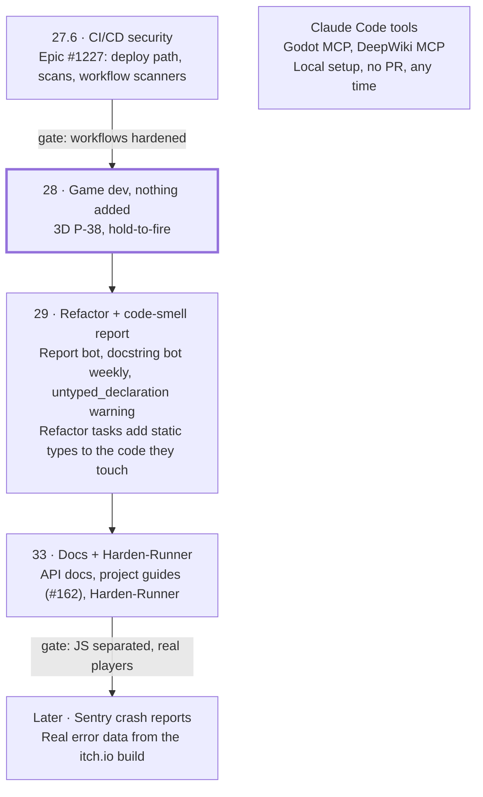

# Dev Automation Plan

Nov 26, 2026

## Summary

Do Milestone 27.6 first. Then add two bots inside existing milestones: the code-smell report in 29 (read-only) and API docs in 33 (no AI). Types go into the refactor work, with no bot. Milestone 28 (game dev) gets nothing added. Sentry waits for the JS separation and real players.

Each milestone keeps its due date. The code-smell report and API docs start only after 27.6 has closed.

## Ground rules

Every task below follows these rules. Most come from decisions already made for the project.

- **AI writes, fixed checks decide.** Every AI flow ends in validators and a scope guard. The PR opens only if they pass, as in the docstring workflow.
- **One task = one PR.** Anything bigger is an epic with sub-tasks.
- **Security before more write access.** New bots get `contents: write` and `pull-requests: write`, so the pipeline is hardened first (Milestone 27.6).
- **Report before rewrite.** A read-only flow ships before any flow that edits code.
- **Cleanup before features.** Automation supports the architecture refactor. It doesn't replace it, and no bot touches game features.
- **One bot per day, one quota per bot.** Scheduled bots never share a day, and each new flow gets its own API key so it can't starve the docstring workflow.
- **Bots open PRs, you merge.** No pushes to `main`, no auto-merge.
- **No new PR review bots.** You already triage four.
- **The refactor stays sequential.** One task at a time, no parallel agents on tangled code.

## Baseline: what exists today

`bi_weekly_gd_docstrings.yml` is the template every new flow copies. Today it runs Sundays and Wednesdays at 00:00 UTC plus manual dispatch (moving to Sundays only, see Bot calendar), one run at a time, with a 30-minute timeout.

1. Audit docstring coverage (`update_gdscript_docs.py --audit`).
2. Gemini writes and injects docstrings (`--write`, `GEMINI_API_KEY`, gemini-3.5-flash-lite on the free tier, about 12 requests/minute).
3. Validate the changed files (`validate_gdscript_docs.py`).
4. `gdlint` on the six production folders (core, entities, managers, resources, system, ui), then `gdformat --check`.
5. Scope guard: fail if a file is added or deleted, or anything changes outside those six folders.
6. Optional GitHub App token, so the PR triggers the other workflows.
7. Open or update one rolling PR from `automation/weekly-gdscript-docs`.

Also in place: CodeRabbit, Sourcery, Qodo, DeepSource (+Autofix), Copilot, Claude Code, CodeQL (JavaScript only), Snyk, Trivy, Dependabot, ImgBot, stale, Release Drafter and All Contributors.

## Phase 1 — Milestone 27.6: CI/CD security

Already planned in epic #1227 (19 tasks, due Jan 16, 2027). This plan adds no tasks to it. It comes first because every later phase adds a bot with write access to a public repo that deploys to itch.io.

**How it contributes:** the coming bots can't be used to leak secrets (the Gemini key, the itch.io deploy credentials) or to slip code into `main`.

| Plan item                      | Covered by                                                                      |
|--------------------------------|---------------------------------------------------------------------------------|
| The epic                       | #1227                                                                           |
| CodeQL `actions` scan + zizmor | #1240 (report-only first, made blocking later)                                  |
| Godot 4.5 vs 4.7.1 mismatch    | #1234 (drops CodeQL's own 4.5 export, scans the deployed build, gates the push) |
| `patch_index_js.sh`            | #1239 (review in depth first, then harden it or drop it)                        |
| Findings                       | #1228–#1238, #1241–#1245                                                        |

**Moved out of 27.6:** Harden-Runner, audit then block mode, goes to Milestone 33. The fork-PR approval setting (Settings → Actions → "Require approval for all outside collaborators") is a settings change with no PR, so do it any time.

## Phase 2 — Code-smell report

The first new AI flow is read-only, so it can't break the game. It automates the kind of audit you did by hand in the ARCHITECT-REVIEW issues #617–#621.

**How it contributes:** keeps the refactor backlog fed, finds hotspots before features land, and the week-to-week trend shows whether the cleanup is working.

**Settings (decided):** weekly, Friday 00:00 UTC. One full scan by hand first to set the baseline, then changed files only (a full scan stays available as a manual-dispatch input). A new report file per run, so each report can show the trend.

**How it works**

- **Layer 1, fixed checks (no AI):** long functions and files, deep nesting, too many parameters, magic numbers, unused functions or signals, TODO/FIXME. Reuses `gdlint` where it already covers a rule.
- **Layer 2, AI review of flagged files only:** god classes, autoload overuse, duplicated logic, tight coupling between scenes, direct calls where a signal fits, test-only JS code in production paths. Runs on its own key; the provider is chosen in task 2.2 (see Open decisions).
- **Output:** `files/docs/code_health/YYYY-MM-DD.md`, with:
    - a summary table per smell type, and the trend since the last report
    - one row per finding: file:line, severity, smell, why it matters, suggested fix, fits one PR?
    - "Already tracked in #NNN" when an open issue covers it, and "Confirm first" on every AI finding
    - the commit it scanned, so the next run starts there
- **Guardrails:** scope guard (only that one new file may appear), a validator that checks every cited file:line exists, markdownlint, a per-run file cap for free-tier limits, and one rolling PR from `automation/code-health-report`.
- **It never opens issues.** You pick findings and turn them into `[TASK]` issues.

**Sub-tasks (an epic, one PR each)**

1. **2.1 — Metrics script** in `.github/scripts/` with pytest tests in `tests/ci/`, runnable locally.
2. **2.2 — AI review step**, plus the file:line validator and the open-issue matching.
3. **2.3 — Workflow wiring:** schedule, scope guard, report template, rolling PR.

## Phase 3 — API docs publish

This turns the docstrings the bot already writes every week into a browsable reference. There's no AI in it: no quota, no output to review.

**How it contributes:** covers the doc generation you already planned, makes the docstring bot's work visible, and gives you and Claude sessions an accurate API map during the refactor and the GUT migration. Test reports, also planned, can go on the same site later.

- **Trigger:** a push to `main` that changes `scripts/**/*.gd` (merged docstring PRs included), plus manual dispatch.
- **Steps:** Godot 4.7.1 headless doctool exports the class reference from GDScript docstrings, a converter turns the XML into HTML or markdown, and the result deploys to the chosen host (see Open decisions).
- **Permissions:** read-only on code; on GitHub Pages, only `pages: write` and `id-token: write` for the deploy.
- **Confirm first:** the exact doctool flags for GDScript docs in 4.7.1 (`--doctool` with `--gdscript-docs`); an existing converter or a small script.

**One docs home:** the same docs site also publishes the hand-written guides from #162 (game mechanics, Godot tutorials, architecture, FAQ, contributing). They live as markdown in the repo and go through PR review. There's no GitHub Wiki.

**Sub-tasks (one PR each)**

1. **3.1 — Generate and convert**, uploaded only as a workflow artifact so you can check the output first.
2. **3.2 — Deploy to the chosen host** and link it from the README.

## Phase 4 — Claude Code session tools

This is local setup with no repo PR, so it can happen any time. Do it before the GUT migration and the coverage-tool work, where it helps most.

**How it contributes:** Claude can check runtime errors and library internals itself, instead of you pasting logs and docs into the session.

- **Godot MCP** (Coding-Solo/godot-mcp, a community tool): launches the editor, runs the project, captures debug output. Review what it can run before enabling it.
    - `claude mcp add godot -e GODOT_PATH=/path/to/godot -- npx @coding-solo/godot-mcp`
- **DeepWiki MCP:** free, no sign-in, works on public repos. Useful for questions about GUT and gdUnit4 internals. Its answers are AI-generated, so treat them as a map, not as the API docs.
    - `claude mcp add -s user -t http deepwiki https://mcp.deepwiki.com/mcp`

## Phase 5 — Typed code through the refactor (no bot)

Typing happens inside the refactor work instead of in a bot. The refactor PRs already rewrite these files, so adding types there costs no milestone time and needs no runner.

**How it contributes:** typed GDScript catches mistakes when the script is parsed, gives better autocompletion and runs faster. That makes the rest of the refactor, and later feature work, safer.

- **Acceptance criterion** on each open refactor issue (#1169, #1180–#1183 in 27; #1100, #1103–#1105, #584 in 29): "Functions and variables touched by this task have static types."
- **Godot setting** `debug/gdscript/warnings/untyped_declaration` → Warn, one tiny PR in 29, so new untyped code gets flagged in the editor.
- **Revisit a bot only after the refactor**, for files it never touched. If that happens, the diff guard from the earlier design applies (only type annotations may change).

## Later — Sentry crash reports

Start this only after the JS separation epic, and once people are playing the itch.io build.

**How it contributes:** real error data from players' browsers, which no test suite gives you.

- The Godot SDK supports Web through the Sentry JS SDK. The free Developer plan covers 1 user and 5K errors a month.
- It adds a new JS dependency to the production build. Doing it after the separation keeps test-only JS and production JS clearly apart.
- Ad blockers can drop reports. Sentry's tunnel workaround needs your own server endpoint, which itch.io's static hosting can't provide.
- Add a short privacy note to the itch.io page.

## Bot calendar and AI quotas

Each bot gets its own day and its own key. Gemini's free limits are per Google project, so a new flow on the docstring bot's key would eat its quota.

| Bot                       | When (UTC)         | AI and key                               | What it may change                        |
|---------------------------|--------------------|------------------------------------------|-------------------------------------------|
| Docstring sync (existing) | Sun 00:00 (weekly) | Gemini, existing key                     | Docstrings in the 6 production folders    |
| Code-smell report         | Fri 00:00          | Provider chosen in task 2.2, its own key | One new file in `files/docs/code_health/` |
| API docs publish          | On push to `main`  | None                                     | The docs site only                        |

**Task:** make the docstring bot weekly in one small PR: change its cron to Sunday only (`0 0 * * 0`), rename `bi_weekly_gd_docstrings.yml` to `weekly_gd_docstrings.yml`, and update any tests or docs that name the old file.

## Not doing, and why

- **Milestone-note draft bot:** you excluded it.
- **Auto-generated tests:** a test can pass and still check nothing, and no automatic check catches that. You'd end up reviewing filler every week.
- **Another PR review bot:** you already triage four.
- **A self-hosted GitHub runner on this public repo:** a fork PR can add its own workflow with `runs-on: self-hosted`, so running your jobs only on a schedule doesn't protect the machine. Only the approval setting stands in the way, and personal accounts have no runner groups to limit which workflows use a runner. One wrong "Approve and run" means code execution on your workstation. If a local AI job is ever needed, use a Windows Task Scheduler job instead.
- **Parallel agents and worktrees:** you found them too complicated, and the refactor needs to stay sequential anyway.
- **Services shut down in 2026 (per your Nov 25 check):** GitHub Models, the free consumer Gemini Code Assist on GitHub, and Gemini CLI's free Google sign-in. Gemini API keys still work.
- **A typing bot, for now:** the refactor PRs already rewrite the code it would touch, so types go in there (Phase 5). A bot would also keep a second rolling PR open on the same files as the docstring bot. Revisit after the refactor, only for files it never touched.

## Where each task lives

Spread across existing milestones. Milestone 28 (game dev) gets nothing, so it starts on schedule.

| Task                                                                | Milestone                 | Why there                                                     |
|---------------------------------------------------------------------|---------------------------|---------------------------------------------------------------|
| Code-smell report, 3 PRs                                            | 29, first tasks           | Feeds the Globals refactor as it starts                       |
| Docstring bot → weekly: cron + rename to `weekly_gd_docstrings.yml` | 29, its own PR            | Changes only the docstring bot                                |
| `untyped_declaration` warning → Warn                                | 29, one tiny PR           | On while the refactor rewrites the most code                  |
| "Touched code is typed" acceptance criterion                        | 27 and 29 refactor issues | Edits to open issues, no new tasks                            |
| API docs publish, 2 PRs                                             | 33, under epic #633       | With the docs and tooling tasks                               |
| Project guides (#162)                                               | 33                        | Published with the API docs; describes the post-refactor code |
| Harden-Runner, audit then block                                     | 33                        | 27.6 is already full and doesn't need it                      |
| Sentry                                                              | No milestone              | Waits for #1184 (JS separation) and real players              |

## Open decisions

- [x] **Where Phases 2, 3 and 5 live:** spread across existing milestones (see "Where each task lives").
- [x] **Code-smell report settings:** weekly; a full scan first, then changed files only; a new file per run.
- [ ] **Code-smell AI provider** (test in task 2.2, then choose):
    - **Gemini API on a separate Google project:** the same client as the docstring script, so the least new code. It has its own free quota, apart from the docstring bot's.
    - **Groq free tier** (e.g. qwen3.8-27b): 30 requests/minute, 1,000/day, 200K tokens/day, with an OpenAI-style API.
    - **OpenRouter `:free` models:** 20 requests/minute and 50/day, or 1,000/day after buying $10 of credits. Same OpenAI-style API, so one client covers it and Groq.
    - **run-gemini-cli** (Google's official Action) on a separate Google project: the least code to write, but the least control over what it reads.

    *How to test:* run each one on the same baseline full scan, then compare useful findings, findings the file:line validator rejects, and whether a weekly run fits the quota.
- [ ] **`patch_index_js.sh`:** still open; reviewed and decided in #1239 before work on it starts.
- [ ] **API docs hosting** (test in task 3.2, then choose):
    - **GitHub Pages:** free for public repos, deploys from the same workflow, no extra account.
    - **Read the Docs:** free for open source, builds from the repo, has versioned docs and search, needs its own account and config.
    - **Cloudflare Pages:** free tier with fast builds; needs a Cloudflare account and an API token as a repo secret.
    - **No hosting:** markdown in the repo, read on GitHub. Nothing to deploy, but the generated API reference loses navigation and search.

    *How to test:* publish the output from task 3.1 to the top two candidates and compare setup effort, how it looks and secrets needed.

**Next step:** file the code-smell epic and its 3 sub-tasks in Milestone 29.
