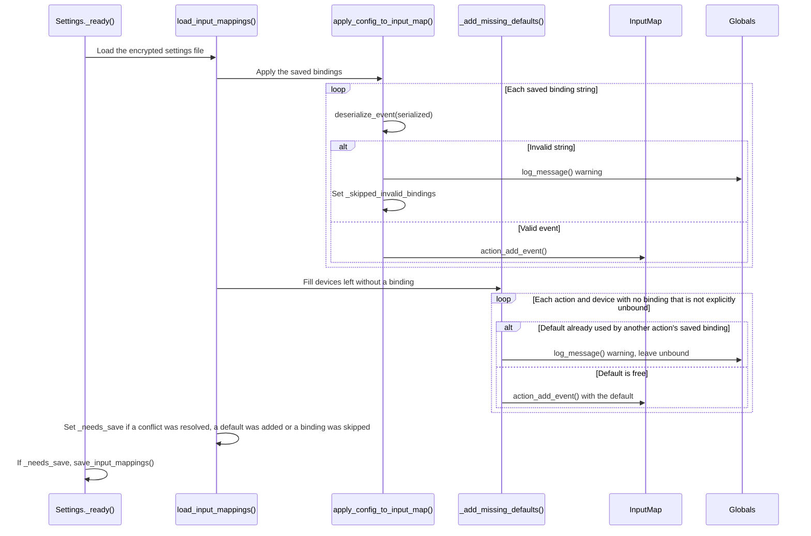
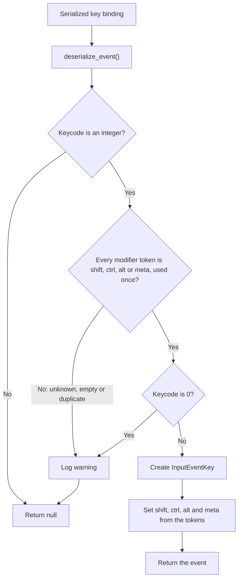

<!-- markdownlint-disable MD001 MD036 MD013 MD033 table-column-style -->
# Bug fixes: README cleanup, legacy doc tags, and key-binding validation

---

## PR #1091 Summary

**Title:** Bug fixes  
**PR:** [#1091](https://github.com/ikostan/SkyLockAssault/pull/1091)  
**Branch:** `bug-fixes` → `main`  
**Author:** @ikostan
**Resolves:**

- [#1088 – [BUG] Legacy Doxygen @param/@return tags left in 7 production scripts; ui_manager.gd is never cleaned by the docs sync](https://github.com/ikostan/SkyLockAssault/issues/1088)
- [#1090 – [BUG] Settings.deserialize_event accepts unknown tokens in key: strings (key:42:bogus loads as a binding)](https://github.com/ikostan/SkyLockAssault/issues/1090)

**Milestone:** Milestone 27: Audio feedback fixes, architecture refactor & performance validation  
**Labels:** bug, testing, GUT

### Purpose

Clear the small, self-contained items in Milestone 27 before the architecture refactor:

1. Fix the README, which had broken contributor avatars and described features, scenes and tooling that no longer match the repo.
2. Remove the last legacy Doxygen doc tags from production scripts (#1088).
3. Stop `Settings.deserialize_event()` from accepting corrupt `key:` bindings (#1090), and close the recovery gaps the review found around it.

---

## Key Changes

### 1. README: contributors section (`README.md`, `.all-contributorsrc`)

- **Broken avatars for @ikostan and espanakosta-jpg.** The generated table used `avatars.githubusercontent.com/u/<login>`, which only accepts a numeric ID. The table now uses the numeric-ID URLs.
- **Wrong app IDs.** Sourcery (`60327` → `48477`) and DeepSource (`54034776` → `16372`) showed the default Octocat.
- **Dead commit and review links.** Bots were listed as `sourcery-ai`, `coderabbitai`, `deepsource-io`; their real logins end in `[bot]`.
- **Missing contributors**, taken from `main`'s commit authors and `Co-authored-by` trailers: Claude, Copilot, DeepSource Autofix, Qodo, ImgBot.

### 2. README: outdated and wrong information (`README.md`)

Every change was checked against the repo.

| Was                                               | Now                                                                                                       |
|---------------------------------------------------|-----------------------------------------------------------------------------------------------------------|
| "multiple weapons, multi-level progression"       | One placeholder level and one weapon (`weapon_types` has a single entry); enemies and progression planned |
| F5 runs `main_menu.tscn`                          | F5 runs `splash_screen.tscn`, which leads to the main menu                                                |
| "Mobile touch controls are experimental"          | Keyboard or gamepad, remappable; no touch controls                                                        |
| "Godot 4.X (or compatible)"                       | Godot 4.7.1, GL Compatibility renderer                                                                    |
| Downloads badge                                   | Removed: releases have no assets, so it always showed 0                                                   |
| Testing: GUT only                                 | GUT (~100 suites), gdUnit4 (27 suites), Playwright (`tests/`)                                             |
| DevOps list                                       | Adds CodeQL, Trivy, lint jobs, Gemini docs workflow, and when each pipeline runs                          |
| Bots list included LlamaPreview                   | LlamaPreview removed (unused); Qodo, Claude Code, Copilot, CodeQL, Trivy, DeepSource Autofix added        |
| Docs table missing 2 docs and the milestone notes | All of `files/docs/` listed; the external Godot docs link moved out of the internal table                 |
| Project structure missing files and folders       | Matches `scripts/` and the top-level layout                                                               |
| Screenshot linked to `blob/main/...`              | Relative path, so it renders on every branch                                                              |

Also removed a tester-only tip and fixed a typo. `.github/SECURITY.md` now says Godot 4.7.1 instead of 4.4 (CodeRabbit finding).

### 3. Legacy Doxygen tags (#1088) (`scripts/`)

- Converted the remaining **81 lines in 6 files** with `migrate_legacy_doxygen()` from `update_gdscript_docs.py`: `hud.gd`, `ui_manager.gd`, `parallax_manager.gd`, `resource_preloader.gd`, `sfx_manager.gd`, `key_mapping.gd`. `player.gd`, listed in the issue, had already been cleaned by the docs sync in #1089.
- `@param x:` → `[param x]:`; `@return: void` lines deleted; other `@return` → `Returns …`. No line was left unconverted.
- One line reworded by hand in `resource_preloader.gd`: the mechanical `Returns Array[Texture2D] - …` trips the validator's BBCode check on `[Texture2D]`.
- Doc comment lines only; no code changes.

### 4. Corrupt `key:` bindings (#1090) (`scripts/core/settings.gd`)

- **`deserialize_event()`:** every token after the keycode must be one of `shift`, `ctrl`, `alt`, `meta` (new `KEY_MODIFIER_TOKENS` constant) and appear at most once. Otherwise the string is rejected with a warning naming the bad token. Modifiers are still accepted in any order, so saves from older builds stay valid. Flags are read from the modifier tokens only.
- **Doc comment** says invalid strings return `null` again (the #1089 wording said unknown tokens were ignored).
- **`apply_config_to_input_map()`** logs a warning when it skips an invalid saved binding instead of dropping it silently.

### 5. Recovery hardening after review (`scripts/core/settings.gd`)

- **No shared inputs from a backfilled default.** `_add_missing_defaults()` now uses a new helper, `_add_default_event()`, which skips a default that another action's **saved** binding already uses. The action stays unbound for that device, a warning is logged, and the player can rebind it. Only bindings loaded from the config count as owners. The project's built-in InputMap deliberately shares keys between gameplay and UI actions (`speed_up`/`ui_up`, `move_left`/`ui_left`), and a first run with no saved settings must still get every default.
- **Corrupt entries are cleaned up.** `apply_config_to_input_map()` sets a new `_skipped_invalid_bindings` flag when it skips an entry, and `load_input_mappings()` includes it in `_needs_save`. The cleaned bindings are saved, so the corrupt entry does not come back on every start. `apply_config_to_input_map()` still does not touch `_needs_save` itself, as its doc comment promises.

### 6. Tests (`test/gut/test_deserialize_event_key_tokens.gd`)

New GUT suite, 33 test methods (more cases with parameters):

- **Token validation:** unknown, misspelled, empty, trailing, duplicate (adjacent and non-adjacent), upper/mixed-case and whitespace tokens are rejected; plain, single, all-four, reordered and reverse-order modifiers load with exactly their own flags; all 16 modifier combinations round-trip; `key:0` is still rejected.
- **Real start-up path:** tests go through `load_input_mappings()` with an encrypted temporary config. They cover the default fallback, a default owned by another saved binding, cleanup saves, explicit unbinds (`[]`, PackedStringArray, single-device), corrupt PackedStringArray entries, invalid non-key entries, the flag reset between loads, a pending save surviving a clean load, and a save → reload round trip.
- **Isolation:** every test restores the global InputMap and the `_needs_save` flag and deletes its temporary config. The suite backs up and restores the real `user://settings.cfg`, because `_default_config()` calls `Settings.reset_to_defaults()`, which saves to it. Without that, running the suite locally replaced the developer's own key bindings with the defaults; this was verified by setting Fire to F, running the suite, and reading Fire back as Space.

### 7. CI wording (`README.md`)

The README no longer claims every suite runs on every pull request. `lint_test_on_pull.yml` uses `dorny/paths-filter`, so each suite runs only when the PR changes files it covers; a README-only PR skips them.

---

## Review Decisions

| Finding                                                                   | Severity | Decision                         | Reason                                                                                                                                                                                                                                                  |
|---------------------------------------------------------------------------|----------|----------------------------------|---------------------------------------------------------------------------------------------------------------------------------------------------------------------------------------------------------------------------------------------------------|
| Sourcery: default bindings remain missing after a rejected `key:` binding | Critical | **Not a bug**, covered by a test | `_add_missing_defaults` runs after the rejected string is skipped and treats only a missing `key:` entry as an explicit unbind, so the default is restored. `test_load_restores_default_for_rejected_binding` passes with and without the review fixes. |
| Sourcery: fallback creates duplicate bindings                             | Medium   | **Fixed** (`a4a1166`)            | Real. A backfilled default could share an input with another action's saved binding. A first version that checked every binding failed 2 gdUnit4 tests because of the intended gameplay/UI overlaps, so the check counts saved bindings only.           |
| Sourcery: corrupt bindings persist                                        | Low      | **Fixed** (`a4a1166`)            | Real. Skipping an invalid entry did not mark settings dirty when nothing else did.                                                                                                                                                                      |
| CodeRabbit: README Godot version disagrees with `SECURITY.md`             | Minor    | **Fixed** (`4db9c02`)            | `SECURITY.md` said 4.4.                                                                                                                                                                                                                                 |
| CodeRabbit: README says all suites run on every PR                        | Minor    | **Fixed** (`04bc078`)            | Suites are path-filtered.                                                                                                                                                                                                                               |

---

## Verification

- `grep -rnE '^\s*##.*(^|[^A-Za-z0-9_])@(param|return|brief)\b' scripts` returns nothing.
- `validate_gdscript_docs.py`: no "Banned Doxygen tag" errors in the converted files; `settings.gd` passes.
- `update_gdscript_docs.py --audit`: 85 COMPLIANT / 47 actionable slots, better than the 61 / 71 expected in #1088.
- `gdlint` and `gdformat --check`: clean on all changed scripts and the new test file.
- `markdownlint-cli2 README.md`: 0 issues.
- Key-token suite: 33/33 pass. Before the #1090 fix, 8 of the first 14 tests failed; before the review fixes, the Medium and Low load tests failed.
- Full GUT suite: 808/808 pass. Full gdUnit4 suite: 155/155 pass.
- Run locally with Godot 4.7.1, GUT 9.7.1 and gdUnit4 6.2.0, the versions CI uses.

---

## Known Limitations / Follow-ups

- **`.all-contributorsrc` was not updated on this branch.** It still has the old 6 entries with no `name`, `avatar_url` or `profile` and the wrong bot logins. The README table is correct now, but the next run of the All Contributors bot regenerates it from that file and brings back the broken avatars and dead links. The matching `.all-contributorsrc` (11 contributors) was prepared in the same session and should be committed.
- **Review replies cite pre-push SHAs.** The replies on the Sourcery and CodeRabbit threads say `8d29871` and `54f1d90`; on the branch those changes are `a4a1166` and `04bc078`.
- **The repo's About description** still says "multiple weapons, multi-level"; it needs the same correction as the README, in the repo settings.
- **12 docs-validator errors remain** in the files touched by #1088. All were already on `main`: missing `[param …]` tags on `play_sfx`, `get_label_text_color` and `show_conflict_dialog`, and `[DIAGNOSTIC]` in four `sfx_manager.gd` comments read as a BBCode tag. The docs sync fills in the missing params.
- **Commit and review links for co-authors.** Copilot's and Claude's 💻 links list only commits they authored, because GitHub's `author=` filter ignores `Co-authored-by` trailers. The credit itself is correct.
- **Avatar URLs were not fetched during the change** (no network access to the image host). Check the contributors table once it renders on GitHub.

---

## Reviewer's Guide (Sourcery)

*Based on Sourcery's guide, with the diagrams and the #1088 row corrected to match the code.*

This PR strengthens input-mapping deserialization and startup recovery against corrupted saved bindings, adds broad regression coverage for fallback, conflict, unbind, and persistence scenarios, and updates project documentation, security metadata, and GDScript comments for Godot 4.7.1.

### Sequence diagram for invalid input binding recovery

### Flow diagram for validated keyboard modifier parsing

### File-Level Changes

| Change                                                                                                                                                                | Details                                                                                                                                                                                                                                                                                                                                                                                                                                        | Files                                                                                                                                                                                                                        |
|-----------------------------------------------------------------------------------------------------------------------------------------------------------------------|------------------------------------------------------------------------------------------------------------------------------------------------------------------------------------------------------------------------------------------------------------------------------------------------------------------------------------------------------------------------------------------------------------------------------------------------|------------------------------------------------------------------------------------------------------------------------------------------------------------------------------------------------------------------------------|
| Harden persisted input-binding parsing and recovery so corrupted mappings are rejected, safely restored when possible, conflict-checked, and persisted after cleanup. | <ul><li>Validate keyboard modifier tokens for unknown, empty, duplicate, and malformed values while preserving valid ordering and combinations.</li><li>Skip invalid saved events, track repair state, and re-save cleaned mappings.</li><li>Backfill missing keyboard and gamepad defaults only when they do not conflict with another saved action.</li><li>Preserve explicit unbinds and existing valid bindings during recovery.</li></ul> | `scripts/core/settings.gd`                                                                                                                                                                                                   |
| Add regression coverage for malformed input data, fallback behavior, conflict handling, and persistence across reloads.                                               | <ul><li>Cover modifier parsing and serialization round trips, including all combinations and malformed sequences.</li><li>Test keyboard/gamepad recovery, saved-binding ownership, explicit unbinds, packed arrays, and non-key corruption.</li><li>Verify cleanup saves remove invalid entries and subsequent loads remain stable.</li><li>Back up and restore the real settings file around the suite.</li></ul>                             | `test/gut/test_deserialize_event_key_tokens.gd` `test/gut/test_deserialize_event_key_tokens.gd.uid`                                                                                                                      |
| Refresh project documentation and security metadata to match the current release, supported scope, workflows, and project structure.                                  | <ul><li>Update Godot version, platform and control guidance, gameplay status, setup flow, architecture, testing, automation, and documentation links.</li><li>Clarify that mobile browsers and touch controls are unsupported and update local web-testing instructions.</li><li>Update security-policy environment references and contributor/automation information.</li></ul>                                                               | `README.md` `.github/SECURITY.md`                                                                                                                                                                                        |
| Standardize GDScript documentation comments to Godot-style parameter and return annotations across managers and UI scripts.                                           | <ul><li>Convert legacy @param/@return comments and remove redundant void annotations.</li><li>Normalize return descriptions for manager, HUD, and key-mapping APIs.</li></ul>                                                                                                                                                                                                                                                                  | `scripts/managers/parallax_manager.gd` `scripts/managers/resource_preloader.gd` `scripts/managers/sfx_manager.gd` `scripts/managers/ui_manager.gd` `scripts/ui/hud.gd` `scripts/ui/menus/key_mapping.gd` |
| Record the PR in the Milestone 27 notes.                                                                                                                              | <ul><li>Add a summary of the changes, review decisions, verification and contributors.</li></ul>                                                                                                                                                                                                                                                                                                                                               | `files/docs/milestones/27/Part_3_Bug_fixes_README_cleanup_legacy_doc_tags_and_key_binding_validation.md`                                                                                                                     |

### Assessment against linked issues

| Issue                                                   | Objective                                                                                                                                                                                                                      | Addressed | Explanation                                                                               |
|---------------------------------------------------------|--------------------------------------------------------------------------------------------------------------------------------------------------------------------------------------------------------------------------------|-----------|-------------------------------------------------------------------------------------------|
| <https://github.com/ikostan/SkyLockAssault/issues/1088> | Remove all legacy Doxygen @param, @return, and @brief tags from production scripts, including the private-function comments in ui_manager.gd, converting or deleting doc lines while leaving non-documentation code unchanged. | ✅        | Six files needed changes; `player.gd` had already been cleaned by the docs sync in #1089. |
| <https://github.com/ikostan/SkyLockAssault/issues/1090> | Reject unknown, empty, and duplicate modifier tokens in `key:` strings while continuing to accept known modifiers in any order and round-trip every string produced by `serialize_event()`.                                    | ✅        |                                                                                           |
| <https://github.com/ikostan/SkyLockAssault/issues/1090> | Update `deserialize_event()` documentation to state that invalid strings return `null` and describe the accepted modifier-token behavior.                                                                                      | ✅        |                                                                                           |
| <https://github.com/ikostan/SkyLockAssault/issues/1090> | When malformed saved bindings are rejected during loading, recover available defaults without creating conflicts, and save the cleaned mappings so corrupt entries do not recur.                                               | ✅        |                                                                                           |

---

## Contributors

### Human contribution (@ikostan)

- Scoped the work: kept Milestone 27 to the quick items and moved the large refactor out of the way of gameplay work.
- Applied, reviewed and pushed all changes, and triaged every review comment (one declined as not a bug, four fixed).
- Notable commits by @ikostan:
  - `3f9bc50` Refresh contributor credits
  - `df32f3b` Update README.md
  - `a7e208c` Refresh README for current game and tooling
  - `c97f80b` Modernize GDScript documentation comments (#1088)
  - `a1cf3a4` Reject invalid key modifier tokens (#1090)
  - `4db9c02` Update SECURITY.md
  - `a4a1166` Harden input binding recovery (review fixes)
  - `f6d69b1` Restore user settings after key token tests

### Bots / AI contributions

- **@claude (Opus 5.5)**
  - Diagnosed the broken contributor avatars (non-numeric avatar URLs, wrong app IDs, wrong bot logins) and found the missing contributors from `main`'s commit authors and `Co-authored-by` trailers; regenerated the table with `all-contributors generate`.
  - Audited the README against the repo (scenes, scripts, docs, workflows, releases, assets) and rewrote the outdated sections.
  - Assessed the Sourcery findings (Critical shown to be a false positive by test; Medium and Low confirmed), implemented the fixes, and narrowed the conflict check after it broke two gdUnit4 tests.
  - Found that the test suite overwrote the real `user://settings.cfg` through `reset_to_defaults()`, proved it, and added the backup/restore.
  - Ran the full GUT and gdUnit4 suites locally against the CI tool versions.

- **@coderabbitai**
  - Authored `6ec1820` Add regression tests for input binding validation and recovery: parameterised token-validation cases, gamepad default recovery, explicit unbinds, PackedStringArray configs, invalid non-key entries, flag reset between loads, and save → reload round trips.
  - Posted two review comments: the Godot version mismatch with `SECURITY.md` and the unconditional PR-test claim in the README. Both fixed.
  - Posted the PR walkthrough and summary comments.

- **@sourcery-ai**
  - Posted three review comments on `settings.gd`: Critical (default bindings remain missing), Medium (fallback creates duplicate bindings), Low (corrupt bindings persist). Medium and Low fixed; Critical declined as not reproducible.
  - Generated the Reviewer's Guide on request (`@sourcery-ai guide`).
  - Originally reported the #1090 bug in its review of #1089.

- **@deepsource-io**
  - Ran automated code review and posted the PR Report Card.

<!-- markdownlint-enable MD001 MD036 MD013 MD033 table-column-style -->
